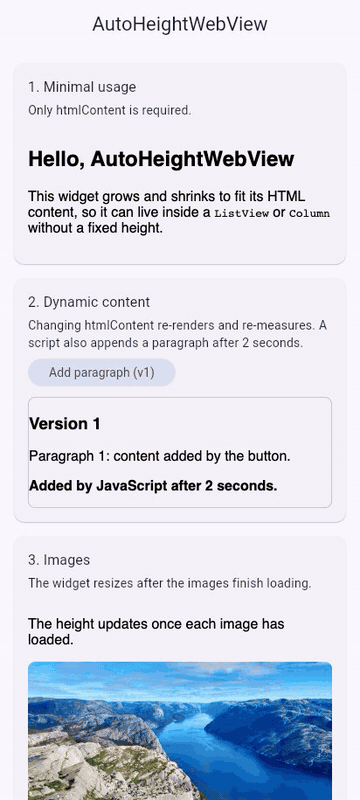

# auto_height_webview

[](https://pub.dev/packages/auto_height_webview)
[](https://pub.dev/packages/auto_height_webview/score)
[](https://pub.dev/packages/auto_height_webview)
[](https://github.com/Rishav1995-roy/auto_height_webview/actions/workflows/ci.yml)
[](LICENSE)


A Flutter widget that renders HTML and sizes itself to the content. Drop it into a `ListView` or `Column` and it takes exactly the height the page needs, then keeps tracking it as images load, fonts swap in or scripts change the DOM. It works on Android, iOS, macOS and the web (iframe, WASM-compatible).

<!-- Demo GIF placeholder: add doc/demo.gif and uncomment the line below.

-->

## Why

| | `webview_flutter` | `flutter_html` / `flutter_widget_from_html` | `auto_height_webview` |
|---|---|---|---|
| Renders real HTML/CSS/JS | Yes | Subset, converted to Flutter widgets | Yes (browser engine) |
| Sizes to content | No, needs a fixed or bounded height | Yes | Yes, and re-measures on image, font and DOM changes |
| Scrolls with the surrounding page | Awkward (nested scrolling) | Yes | Yes, with optional `maxHeight` + inner scroll |
| Handles JS-generated content | Yes | No | Yes |
| Several instances on one screen | Manual sizing per view | Yes | Yes, each sized independently |
| Link taps | Navigate inside the view | Callback | Callback, in-view navigation blocked by default |
| Web (incl. WASM) | Limited | Yes | Yes |
| Extra dependencies | – | Several | Only `webview_flutter` + `web` |

Use `flutter_html` or `flutter_widget_from_html` when your content is simple markup and you want native widgets. Use plain `webview_flutter` when the web view is a full-screen page. Use this package when you need real browser rendering (full CSS, JavaScript, embeds) inside a scrolling layout, such as articles, emails, rich product descriptions or CMS content.

## Features

- Automatic height, tracked with `ResizeObserver` (with a `MutationObserver` fallback), image and font load events, throttled with `requestAnimationFrame`
- `minHeight` / `maxHeight` clamping, optionally with inner scrolling (`scrollWhenClamped`)
- Animated height changes
- Full HTML documents are detected and not wrapped twice
- Link handling: `onLinkTap` with in-view navigation blocked by default
- Extra CSS, default style reset, custom JavaScript, `baseUrl`
- Custom loading indicator and `onPageFinished` callback
- Same widget and API on Android, iOS, macOS and web

## Platform support

| Android | iOS | macOS | Web | Windows | Linux |
|---|---|---|---|---|---|
| Yes | Yes | Yes | Yes (iframe, WASM) | No | No |

## Installation

```sh
flutter pub add auto_height_webview
```

or in `pubspec.yaml`:

```yaml
dependencies:
  auto_height_webview: ^0.0.2
```

Requires Dart `^3.6.0` and Flutter `>=3.27.0`. Tested in CI on Flutter 3.27 and the latest stable (3.47 at release).

## Quick start

```dart
import 'package:auto_height_webview/auto_height_webview.dart';

AutoHeightWebView(
  htmlContent: '<h2>Hello</h2><p>This view is exactly as tall as its content.</p>',
)
```

## Examples

### Inside a scrolling list

```dart
ListView(
  padding: const EdgeInsets.all(16),
  children: [
    const Text('Article', style: TextStyle(fontSize: 24)),
    AutoHeightWebView(htmlContent: articleHtml),
    const Divider(),
    AutoHeightWebView(htmlContent: commentsHtml),
  ],
)
```

The web view does not capture vertical drags on mobile by default, so the list keeps scrolling normally.

### Min / max height and inner scrolling

```dart
AutoHeightWebView(
  htmlContent: longHtml,
  minHeight: 120,
  maxHeight: 400,
  scrollWhenClamped: true, // once 400 is reached, the content scrolls inside
  onHeightChanged: (h) => debugPrint('height: $h'),
)
```

Without `scrollWhenClamped`, content taller than `maxHeight` is clipped.

### Open links with url_launcher

`url_launcher` is not a dependency of this package; add it to your app.

```dart
import 'package:url_launcher/url_launcher.dart';

AutoHeightWebView(
  htmlContent: html,
  onLinkTap: (url) => launchUrl(
    Uri.parse(url),
    mode: LaunchMode.externalApplication,
  ),
)
```

### Custom CSS and dark mode

```dart
final isDark = Theme.of(context).brightness == Brightness.dark;

AutoHeightWebView(
  htmlContent: html,
  css: '''
    body { color: ${isDark ? '#e6e6e6' : '#1a1a1a'}; font-size: 16px; }
    a { color: ${isDark ? '#8ab4f8' : '#1a73e8'}; }
    img { max-width: 100%; height: auto; }
  ''',
)
```

### Full HTML document

Documents that start with `<!doctype` or `<html` (leading whitespace and comments are fine) are used as they are, with no extra wrapper. A fragment that only mentions `<html>` somewhere inside, for example in an `srcdoc` attribute, is still wrapped.

```dart
AutoHeightWebView(
  htmlContent: '''
    <!DOCTYPE html>
    <html>
      <head><meta name="viewport" content="width=device-width"></head>
      <body><h1>Standalone page</h1></body>
    </html>
  ''',
  useDefaultStyles: false,
)
```

### Custom loading indicator

```dart
AutoHeightWebView(
  htmlContent: html,
  loadingBuilder: (context) => const Center(child: Text('Loading...')),
  onPageFinished: () => debugPrint('page loaded'),
)
```

## Parameters

| Parameter | Type | Default | Description |
|---|---|---|---|
| `htmlContent` | `String` | required | HTML to render. Changing it reloads the content. |
| `initialHeight` | `double?` | `100` | Height used before the first measurement. |
| `minHeight` | `double?` | `50` | Lower bound for the measured height. |
| `maxHeight` | `double?` | none | Upper bound for the measured height. |
| `onHeightChanged` | `ValueChanged<double>?` | none | Called when the height changes. |
| `decoration` | `BoxDecoration?` | none | Decoration around the view (border, radius, background). |
| `customScript` | `String?` | none | JavaScript run after the page loads. |
| `enableJavaScript` | `bool` | `true` | Live height measurement needs JS. When `false`: mobile keeps `initialHeight`; web measures once, at load. |
| `css` | `String?` | none | Extra CSS appended in `<head>`. |
| `useDefaultStyles` | `bool` | `true` | Reset body margin/padding and use a sans-serif font. |
| `baseUrl` | `String?` | none | Base for relative URLs. Mobile: `baseUrl` of `loadHtmlString`. Web: `<base href>`. |
| `onLinkTap` | `ValueChanged<String>?` | none | A link was tapped or the page tried to navigate. Receives the URL. |
| `allowNavigation` | `bool` | `false` | When `false`, in-view navigation after the first load is blocked and reported to `onLinkTap`. |
| `loadingBuilder` | `WidgetBuilder?` | `CircularProgressIndicator` overlay | Builds the loading overlay shown until the first load finishes. |
| `onPageFinished` | `VoidCallback?` | none | Called when the page finishes loading. |
| `scrollWhenClamped` | `bool` | `false` | Once `maxHeight` is reached, let the content scroll inside the view. |
| `gestureRecognizers` | `Set<Factory<OneSequenceGestureRecognizer>>?` | none (empty set; a vertical drag while `scrollWhenClamped` applies) | Gestures the web view claims, replacing the default. Mobile only. |
| `animationDuration` | `Duration` | `300 ms` | Duration of height animations. |
| `animationCurve` | `Curve` | `Curves.easeInOut` | Curve of height animations. |

## How it works

```
 htmlContent
     |
     v
 wrap in a document (skipped for full HTML) + inject styles and measuring script
     |
     v
 +---------------------------+     height (px)     +-------------------+
 | WebView (mobile)          | ------------------> | Flutter widget    |
 | or <iframe srcdoc> (web)  |   JS channel /      | clamp to min/max, |
 |                           |   postMessage       | animate container |
 | ResizeObserver +          |                     | -> onHeightChanged|
 | MutationObserver, image & |                     +-------------------+
 | font load, rAF-throttled  |
 +---------------------------+
```

The measuring script reports `document` height whenever the layout changes. The widget clamps it, ignores repeated identical values, and animates its own height to match.

## Platform notes

- **Android:** `minSdkVersion 21` or higher (required by `webview_flutter_android`).
- **iOS:** no special configuration.
- **macOS:** if the HTML loads remote resources (images, fonts, scripts), enable the network client entitlement in `macos/Runner/DebugProfile.entitlements` and `Release.entitlements`:
  ```xml
  <key>com.apple.security.network.client</key>
  <true/>
  ```
- **Web:** content is rendered in an `<iframe>` using `srcdoc`. The `srcdoc` document inherits the Content Security Policy of your host page, so a strict policy must allow the inline measuring script (for example `script-src 'unsafe-inline'`) and the origins your HTML loads from; without it the height cannot be measured. A `frame-src` / `child-src` directive that is set explicitly should also allow `about:srcdoc`. Each instance reports its own height, so many can live on one page.

## Limitations

- Live height tracking needs JavaScript. With `enableJavaScript: false` the web implementation measures the iframe once, at load, from the parent page; mobile keeps `initialHeight`.
- Cross-origin content loaded inside an iframe within your HTML cannot be measured; the iframe element's own size is used.
- With `maxHeight` set and `scrollWhenClamped: false`, content beyond the limit is clipped.
- Windows and Linux are not supported.

## Migrating from 0.0.1

There are no breaking changes. Existing code compiles unchanged.

- `onHeightChanged` is now `ValueChanged<double>` (source-compatible with a `Function(double)` callback).
- `htmlContent` changes are now applied, and links no longer navigate inside the view unless you set `allowNavigation: true`.
- `flutter_inappwebview`, `universal_html` and `js` are no longer dependencies; remove any imports you relied on transitively.

See the [CHANGELOG](CHANGELOG.md) for the full list.

## Contributing

Issues and pull requests are welcome. Before opening a PR, run:

```sh
flutter analyze
flutter test
dart format lib test
```

## License

[MIT](LICENSE) (c) 2025 Rishav Deb Roy
